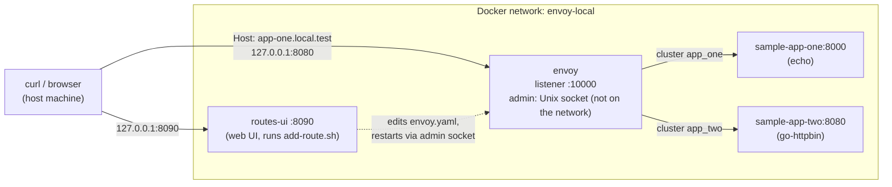

# envoy-local

A local HTTP front proxy built on **Envoy's native configuration** (listeners, virtual hosts, routes, clusters) and run with Docker Compose.

It gives local development hostname- and path-based routing that behaves like production routing. Production runs Envoy Gateway on EKS with Gateway API resources. This project does not reproduce that infrastructure: no Kubernetes, no Envoy Gateway, no AWS. See [docs/production-parity.md](docs/production-parity.md) for what matches and what doesn't.

The project is standalone: it ships with two sample backends. Later, Envoy can join existing application Docker networks without changing those applications. See [Integrating with an existing app](#integrating-with-an-existing-app).

## Contents

- [Architecture](#architecture)
- [Prerequisites](#prerequisites)
- [Quick start](#quick-start)
- [Open in a browser](#open-in-a-browser)
- [Example requests](#example-requests)
- [Routing table](#routing-table)
- [Route to your app](#route-to-your-app)
- [Validation and tests](#validation-and-tests)
- [Logs, diagnostics, troubleshooting](#logs-diagnostics-troubleshooting)
- [Ports and hostnames](#ports-and-hostnames)
- [Integrating with an existing app](#integrating-with-an-existing-app)
- [Security considerations](#security-considerations)
- [Known limitations](#known-limitations)
- [Project layout](#project-layout)

## Architecture



- **Envoy** is built from [envoy/Dockerfile](envoy/Dockerfile), following the reference example's pattern: the official `envoyproxy/envoy:v1.40.2` image, plus `curl` for diagnostics, plus [envoy/scripts/entrypoint.sh](envoy/scripts/entrypoint.sh). The entrypoint prints the version, config path and log level, can dump the config (`ENVOY_DUMP_CONFIG=true`), and starts Envoy. Unlike the reference, it does not rewrite the YAML with `sed`: the mounted [envoy/envoy.yaml](envoy/envoy.yaml) is exactly what runs.
- **app-one** ([examples/app-one](examples/app-one)) is a small stdlib-Python echo server. Its JSON shows that it answered, plus the path and headers it received.
- **app-two** ([examples/app-two](examples/app-two)) is [go-httpbin](https://github.com/mccutchen/go-httpbin) `2.25.0`, the maintained successor to the `httpbin` image the reference used. It's useful for `/anything`, `/status/<code>` and `/delay/<seconds>`.
- **routes-ui** ([routes-ui](routes-ui)) is a small web UI at http://127.0.0.1:8090/ to list, add and remove routes. It runs the same `scripts/add-route.sh` developers use from the terminal. See [Routes web UI](#routes-web-ui).
- Only Envoy's HTTP listener and the routes UI are published, both on host loopback by default. Backends and the admin interface are not reachable from the host.

More detail: [docs/architecture.md](docs/architecture.md) · [docs/routing.md](docs/routing.md) · [docs/production-parity.md](docs/production-parity.md)

## Prerequisites

- Docker Engine with Compose v2.20 or later (`docker compose version`); Docker Desktop works. Tested with Docker 28.1.1 and Compose 2.35.1 on macOS (arm64).
- `curl` and `bash` for the scripts. macOS's built-in bash 3.2 is enough.
- Optional: `python3`. The smoke test uses it to run a temporary service on your machine when testing `add-route.sh … host:PORT`, and skips that check if it's missing. Some examples also use it to pretty-print JSON.
- No AWS, Kubernetes or certificates are needed.

## Quick start

```bash
cp .env.example .env              # optional; all values have defaults
docker compose up -d --build --wait
./scripts/smoke-test.sh           # optional: full end-to-end check
open http://127.0.0.1:8090/       # routes web UI (macOS; or paste the URL in a browser)
```

| Task | Command |
|---|---|
| Start (build sample image, wait for health checks) | `docker compose up -d --build --wait` |
| Status | `docker compose ps` |
| Follow Envoy logs | `docker compose logs -f envoy` |
| Validate config without starting | `./scripts/validate.sh` |
| Apply an `envoy.yaml` change | `./scripts/validate.sh && docker compose restart envoy` |
| Run smoke tests | `./scripts/smoke-test.sh` (add `--down` to stop afterwards) |
| Stop and remove containers and network | `docker compose down` |
| Stop without removing | `docker compose stop` |

`--wait` makes Compose block until every health check passes. Without it, `docker compose up -d --build` also works but returns immediately.

## Open in a browser

`app-one.local.test` and `app-two.local.test` are not real DNS names, and `.test` never resolves on its own. Until your machine maps them to `127.0.0.1`, a browser shows "site can't be reached" even though Envoy is running. You need two things: a hosts-file entry and the right port.

### 1. Add the hostnames to your hosts file (one time)

**macOS**

```bash
echo '127.0.0.1 app-one.local.test app-two.local.test' | sudo tee -a /etc/hosts
sudo dscacheutil -flushcache; sudo killall -HUP mDNSResponder
```

**Linux**

```bash
echo '127.0.0.1 app-one.local.test app-two.local.test' | sudo tee -a /etc/hosts
# only if your distro uses systemd-resolved:
sudo resolvectl flush-caches
```

**Windows:** open Notepad *as Administrator*, edit `C:\Windows\System32\drivers\etc\hosts`, add the line below, save, then run `ipconfig /flushdns`:

```text
127.0.0.1 app-one.local.test app-two.local.test
```

Check that it resolves:

```bash
ping -c 1 app-one.local.test            # should show 127.0.0.1 (Windows: ping -n 1 ...)
curl http://app-one.local.test:8080/    # should return app-one's JSON
```

The hosts file doesn't support wildcards (`*.local.test`), so **every new hostname you add to `envoy.yaml` also needs to be added to this line**.

To undo, delete the line from the hosts file (on macOS/Linux: `sudo nano /etc/hosts`) and flush the cache again.

### 2. Open the URLs with the port and `http://`

| URL | Expected |
|---|---|
| http://app-one.local.test:8080/ | app-one echo JSON |
| http://app-one.local.test:8080/status/418 | app-two (httpbin) "I'm a teapot" |
| http://app-two.local.test:8080/ | go-httpbin home page |
| http://app-two.local.test:8080/api/items?page=2 | httpbin JSON, `"url"` shows `/anything/items?page=2` (rewritten) |
| http://app-two.local.test:8080/delay/5 | `upstream request timeout` (504) after 3s |
| http://app-two.local.test:8080/other | blank 404 (no route) |

- **Include the port.** Envoy listens on `8080`, so `http://app-one.local.test/` (port 80) reaches nothing.
- **Type `http://` explicitly.** Some browsers try `https://` first, and this setup has no HTTPS yet.

### Optional: drop the `:8080`

Publish Envoy on port 80 by setting this in `.env`:

```bash
ENVOY_HTTP_PORT=80
```

Then run `docker compose up -d` and open `http://app-one.local.test/`. Docker Desktop on macOS normally allows port 80 without root. If another program already uses it (for example a local web server), `up` fails with "port is already allocated". In that case keep `8080`. When using port 80, the `curl` examples in this README also work without `:8080`.

## Example requests

The `.test` hostnames don't resolve by themselves. Add them to your hosts file ([Open in a browser](#open-in-a-browser)), or skip that with either option:

```bash
# Option A: send the Host header explicitly
curl -H 'Host: app-one.local.test' http://127.0.0.1:8080/

# Option B: resolve the name for one curl call (sends Host: app-one.local.test:8080)
curl --resolve app-one.local.test:8080:127.0.0.1 http://app-one.local.test:8080/
```

More examples:

```bash
H=http://127.0.0.1:8080
curl -H 'Host: app-one.local.test' $H/                   # -> app-one (echo JSON)
curl -i -H 'Host: app-one.local.test' $H/status/418      # -> app-two (httpbin), 418
curl -H 'Host: app-two.local.test' $H/                   # -> app-two (httpbin home page)
curl -H 'Host: app-two.local.test' "$H/api/items?page=2" # -> app-two, path /anything/items?page=2 (rewritten)
curl -i -H 'Host: app-two.local.test' $H/delay/5         # -> 504 after 3s (route timeout)
curl -i -H 'Host: app-two.local.test' $H/other           # -> 404 (no route for this path)
curl -i -H 'Host: unknown.local.test' $H/                # -> 404 (no virtual host)
```

Shortened app-one response:

```json
{
  "service": "app-one",
  "path": "/",
  "host": "app-one.local.test",
  "headers": { "x-forwarded-for": "172.21.0.1", "x-forwarded-proto": "http", "x-request-id": "…" }
}
```

## Routing table

| Host | Path match | Backend (cluster) | Upstream path | Route name |
|---|---|---|---|---|
| `app-one.local.test` | prefix `/status` (segment-aware) | `app_two` | unchanged | `app-one-status-prefix` |
| `app-one.local.test` | prefix `/ws` (WebSocket; no request timeout) | `app_one` | unchanged | `app-one-websocket` |
| `app-one.local.test` | prefix `/` (catch-all) | `app_one` | unchanged | `app-one-default` |
| `app-two.local.test` | prefix `/api` | `app_two` | `/api` replaced by `/anything` | `app-two-api-rewrite` |
| `app-two.local.test` | prefix `/delay` (3s timeout) | `app_two` | unchanged | `app-two-delay` |
| `app-two.local.test` | exactly `/` | `app_two` | unchanged | `app-two-root` |
| `app-two.local.test` | anything else | — | — | **404**, flag `NR` |
| any other host | — | — | — | **404**, flag `NR` |

"Segment-aware" means `/status` matches `/status` and `/status/418` but not `/statuses`, the same as Gateway API `PathPrefix`. Routes are evaluated top to bottom and the first match wins. Details are in [docs/routing.md](docs/routing.md).

## Route to your app

This is the everyday workflow: you are developing an app and want `myapp.local.test` to reach it through Envoy, like its production hostname reaches it through Envoy Gateway.

### 1. Pick the target for where your app runs

| Where your app runs | Target | How Envoy reaches it |
|---|---|---|
| Directly on your machine (`npm run dev`, `go run`, IDE…) on port 3000 | `host:3000` | `host.docker.internal:3000` (works even if the app listens only on `127.0.0.1` with Docker Desktop; on Linux it must listen on `0.0.0.0`) |
| In a container that **publishes** a port (`ports: ["3000:3000"]`) | `host:3000` | The same, through the published port. No network changes needed. |
| In a container **without** published ports | `container:<container-name>:<container-port>` | Docker DNS. Envoy must first join that app's network ([Integrating with an existing app](#integrating-with-an-existing-app)). |

Use the port the app listens on: the host port for `host:`, the port **inside** the container for `container:`. Find container names with `docker ps --format '{{.Names}}\t{{.Ports}}'`.

### 2. Add routes

One route sends a hostname (and optionally a path prefix) to one target. Add as many as you need per hostname:

```bash
# Everything on myapp.local.test -> the frontend on your machine
./scripts/add-route.sh myapp.local.test host:3000

# myapp.local.test/api/... -> the API container, with /api stripped (/api/items arrives as /items)
./scripts/add-route.sh myapp.local.test container:myapp-api-1:8080 --path /api --rewrite /

# A separate hostname for one container
./scripts/add-route.sh api.local.test container:myapp-api-1:8080
```

| Option | Meaning | Gateway API equivalent |
|---|---|---|
| `--path /api` | Route requests whose path is `/api` or starts with `/api/` (not `/apix`). Default `/`, which means everything. | `matches[].path` `PathPrefix` |
| `--rewrite /` | Replace the matched prefix before forwarding: `/api/items` → `/items`. | `URLRewrite` `ReplacePrefixMatch: /` |
| `--rewrite /v2` | `/api/items` → `/v2/items`. Not allowed with `--path /`. | `ReplacePrefixMatch: /v2` |

The script:

1. writes a native virtual host (one line per route) and one cluster per distinct target into [envoy/envoy.yaml](envoy/envoy.yaml), before the `@add-route` markers;
2. **orders the routes** longest prefix first, with `/` last, because Envoy uses the first route that matches (Gateway API sorts by specificity the same way);
3. runs `./scripts/validate.sh`, and restores the file if Envoy rejects it;
4. restarts Envoy (a few seconds) and waits until it's healthy;
5. warns if Envoy can't reach the target yet (app not started, container not on a shared network);
6. prints the `curl` command, and the `/etc/hosts` line if the hostname isn't there yet.

Then add the hostname to your hosts file ([Open in a browser](#open-in-a-browser)) and open `http://myapp.local.test:8080/`.

Other commands:

```bash
./scripts/add-route.sh --list                                # hostnames, routes, targets, rewrites
./scripts/add-route.sh --remove myapp.local.test --path /api # one route (unused cluster removed too)
./scripts/add-route.sh --remove myapp.local.test             # the whole hostname (restores envoy.yaml exactly)
./scripts/add-route.sh myapp.local.test host:3000 --no-restart   # edit + validate only
```

Generated example (`envoy.yaml`, after the two `myapp` commands above):

```yaml
# --- add-route: myapp.local.test ---
- name: myapp.local.test
  domains: ["myapp.local.test"]
  routes:
    - { name: "myapp.local.test /api", match: { path_separated_prefix: /api }, route: { cluster: myapp_local_test__myapp_api_1_8080, timeout: 15s, regex_rewrite: { pattern: { regex: '^/api/*' }, substitution: / } } }
    - { name: "myapp.local.test /", match: { prefix: / }, route: { cluster: myapp_local_test__host_docker_internal_3000, timeout: 15s } }
# --- end add-route: myapp.local.test ---
```

(`--rewrite /` uses a regex because a plain `prefix_rewrite: /` would turn `/api/items` into `//items`; see [docs/routing.md](docs/routing.md#rewriting).)

### Routes web UI

The same thing from a browser: **http://127.0.0.1:8090/**. It starts with the stack (`docker compose up`).

- **Hostnames table:** every virtual host in `envoy.yaml` (the samples, hand-written ones, and ones added by the script). Each route is listed in match order with its backend, any rewrite, and a live status. The status is the code Envoy returns for `GET <path>` on that host: `200`, `404` if nothing matches or the app returns 404, `503` if the backend isn't reachable. Each hostname links to `http://<host>:8080/`.
- **Add a route:** hostname, where the app runs ("on my machine / published port" = `host:PORT`, or "in a container" = `container:NAME:PORT`), port, **path prefix** (default `/`) and an optional **rewrite prefix**. It runs `scripts/add-route.sh` inside the `routes-ui` container: same validation, ordering, rollback and messages as the terminal. Envoy restarts in about a second.
- **`+ path`** on a hostname fills the form to add another path to it. **`×`** removes one route. **Remove host** removes the hostname with all its routes. These buttons appear only on hostnames created by `add-route.sh` (from the UI or the terminal). Hand-written hosts are read-only here; edit them in `envoy.yaml`.
- **Hosts-file line** with every configured hostname, ready to copy.

The UI and the script edit the same `envoy/envoy.yaml`, so you can mix them. Changes show up in `git diff` like any other edit.

How it works, without the Docker socket:

- `routes-ui` is built from the same pinned Envoy image, so it validates with the exact same Envoy binary.
- It can write only the `./envoy` folder.
- It restarts Envoy by calling the admin's `/quitquitquit` through the shared admin socket, and Docker's restart policy starts Envoy again.

The UI only answers requests addressed to `127.0.0.1`/`localhost`, and only accepts changes as JSON from its own page, so other websites open in your browser can't add or remove routes.

### 3. Anything else: edit `envoy.yaml` by hand

The script and the UI cover hostname + path prefix + optional prefix rewrite, with a fixed 15s timeout. For exact paths, header matches, redirects, other timeouts or retries, write the routes by hand in `envoy.yaml`, using the patterns in [docs/routing.md](docs/routing.md#adding-routes) and the HTTPRoute mapping in [docs/production-parity.md](docs/production-parity.md#native-routes--httproute-mapping). Then run `./scripts/validate.sh && docker compose restart envoy`.

Two ways to do that:

- **A separate, hand-written virtual host** (recommended for mirroring a production `HTTPRoute` in full). The UI shows it read-only.
- **Edit a generated block.** Once its lines no longer have the one-line-per-route shape, the script and the UI **refuse to modify that hostname** rather than guess, and tell you so. `--remove <host>` (the whole hostname) still works. If you add nothing but comments, keep them outside the markers.

### Sharing routes with the team

All routes live in `envoy/envoy.yaml`, which is committed:

- **Routes that mirror production** (the team's apps and their real hostnames as `*.local.test`): commit them, so everyone gets the same routing.
- **Personal or experimental routes** (your own port, a quick test): don't commit them. Remove them with `--remove` or discard the change with `git checkout envoy/envoy.yaml`.
- A route whose target isn't running doesn't break anything: Envoy starts normally and only that hostname returns 503. A committed route for an app a teammate isn't running is harmless.

There is no hot reload. Envoy loads `envoy.yaml` at startup, so every change needs a restart, which `add-route.sh` does for you. Loading routes from separate watched files was tested, but Docker Desktop doesn't deliver the file-change events to the container, so the reload never triggered.

### Manual alternative

Adding a hostname by hand takes two blocks in [envoy/envoy.yaml](envoy/envoy.yaml), which is exactly what the script writes:

1. **Add a cluster** under `static_resources.clusters`, pointing at the backend's Docker DNS name (or `host.docker.internal`) and port:

   ```yaml
   - name: app_three
     type: STRICT_DNS
     dns_lookup_family: V4_ONLY
     connect_timeout: 5s
     load_assignment:
       cluster_name: app_three
       endpoints:
         - lb_endpoints:
             - endpoint:
                 address:
                   socket_address: { address: app-three, port_value: 3000 }
   ```

2. **Add a virtual host** under `route_config.virtual_hosts`:

   ```yaml
   - name: app-three
     domains: ["app-three.local.test"]
     routes:
       - name: app-three-default
         match: { prefix: / }
         route: { cluster: app_three, timeout: 15s }
   ```

3. Run `./scripts/validate.sh && docker compose restart envoy`, then test with `curl -H 'Host: app-three.local.test' http://127.0.0.1:8080/`.
4. To open it in a browser, add `app-three.local.test` to the hosts-file line ([Open in a browser](#open-in-a-browser)).

To run a new *sample* backend inside this project, add a service to [compose.yaml](compose.yaml) without `ports:`.

A cluster whose name doesn't resolve doesn't stop Envoy from starting; only that host returns 503. So routes for apps that aren't running are harmless.

For more route features (exact paths, rewrites, header matches, redirects, per-route timeouts), see [docs/routing.md](docs/routing.md#adding-routes).

## Validation and tests

```bash
./scripts/validate.sh      # docker compose config + `envoy --mode validate` in the pinned image
./scripts/smoke-test.sh    # 52 checks: validation, startup, routing, timeouts, failures, exposure, add-route, routes UI, restart
```

`validate.sh` runs Envoy's own validation mode with the same image, user and read-only mount as the real container. It fails on any error *and* on deprecated-field warnings.

`smoke-test.sh` covers: startup and health, hostname routing, segment-aware prefix routing, rewriting, the per-route timeout (504), unknown hosts and paths, forwarding-header behavior (with and without client `X-Forwarded-For`), WebSocket upgrade, a stopped backend (503 with failure flags in the log) and recovery, admin non-exposure (from the host and from another container), `add-route.sh` (container and host targets, a second path with a rewrite, route ordering, removing one route and then the hostname; the test leaves `envoy.yaml` unchanged), the routes UI API (the same operations, plus the cross-origin and `Host` header protections), and a full `down` and `up` restart. It waits on health checks and polls; it never relies on fixed sleeps for startup.

## Logs, diagnostics, troubleshooting

Each request produces one access-log line on Envoy's stdout:

```text
[2026-10-27T11:34:13.876Z] "GET / HTTP/1.1" status=503 flags=UF details=upstream_reset_before_response_started{connection_timeout}
host=app-two.local.test route=app-two-root cluster=app_two upstream=172.21.0.4:8080 duration_ms=5005 upstream_ms=-
bytes_in=0 bytes_out=91 client=172.21.0.1 xff="172.21.0.1" request_id=bb42ac09-… upstream_failure="-" ua="curl/8.7.1"
```

(The real line is a single line.) The logged path is the one sent upstream, after any rewrite. Every response carries an `x-request-id` header. To find the log line for a failing request:

```bash
docker compose logs envoy | grep <x-request-id>
```

| Symptom | `flags` / `details` | Meaning and fix |
|---|---|---|
| 404, empty body | `NR` / `route_not_found` | No virtual host for the `Host` header, or no route for the path. Check the hostname spelling and `route_config`. |
| 503 after about 5s | `UF` / `…{connection_timeout}` | The backend IP no longer answers (for example the container just stopped). Fails after `connect_timeout`. |
| 503 immediately | `UF` / `…{connection_failure}` | Connection refused: the container is up, but nothing listens on that port. Check `port_value`. |
| 503 immediately | `UH` / `no_healthy_upstream` | DNS name doesn't resolve: the container isn't running or isn't on a shared network. |
| 504 | `UT` / `response_timeout` | Backend slower than the route `timeout` (15s by default; 3s on `/delay`). Try `/delay/5` on app-two. |
| 408 | details name the request-headers timeout | The client didn't finish sending headers within `request_headers_timeout` (10s). |

### Envoy admin interface

The admin interface listens on a **Unix socket** (`/run/envoy-admin/admin.sock`, in the shared `envoy-admin` volume), not on a network port, so by default **it has no URL you can open in a browser**. This is deliberate: the admin API has no authentication and can change Envoy's state (for example `POST /quitquitquit` stops it). There are two ways to use it.

**From the terminal (default, always available).** `admin.sh` takes the admin path you want; with no argument it calls `/ready` and prints `LIVE` when Envoy is ready.

```bash
./scripts/admin.sh                      # LIVE = Envoy ready
./scripts/admin.sh /help                # list every admin page
./scripts/admin.sh /clusters            # resolved endpoints and health per cluster
./scripts/admin.sh /config_dump | python3 -m json.tool | less   # active configuration
./scripts/admin.sh '/stats?filter=app_two'
./scripts/admin.sh /server_info         # version, state, uptime
docker compose exec envoy curl -s --unix-socket /run/envoy-admin/admin.sock localhost/clusters   # same, directly
docker compose exec envoy getent hosts sample-app-two       # does Docker DNS resolve it?
```

**In a browser (opt-in, temporary).** [compose.admin.yaml](compose.admin.yaml) adds a small `socat` forwarder that connects to the admin socket and publishes it on host loopback. It keeps working when Envoy restarts.

```bash
docker compose -f compose.yaml -f compose.admin.yaml up -d --wait
# open http://127.0.0.1:9901/      (port configurable with ENVOY_ADMIN_PORT in .env)

docker compose up -d --wait --remove-orphans    # close it again
```

`envoy.yaml` doesn't change, and the admin is only published on `127.0.0.1`. While the override is active, though, **any process on your machine and any container on the `envoy-local` network can call the admin, including endpoints that stop or reconfigure Envoy.** Use it while diagnosing, then close it. Don't add it to `COMPOSE_FILE` permanently. `smoke-test.sh` starts the stack without this file, so running it also closes admin access.

Useful pages once it's open:

| URL | Shows |
|---|---|
| http://127.0.0.1:9901/ | Home: every admin endpoint with its description, plus buttons to run them |
| http://127.0.0.1:9901/stats?format=active-html | **Live metrics**, auto-refreshing and filterable (try `app_two` or `upstream_rq_5xx`). The closest thing to a dashboard. |
| http://127.0.0.1:9901/stats?format=html | Metrics as HTML with a filter (no auto-refresh) |
| http://127.0.0.1:9901/clusters | Backends, resolved IPs and health |
| http://127.0.0.1:9901/config_dump | Full active configuration (JSON) |
| http://127.0.0.1:9901/server_info | Version, state, uptime |
| http://127.0.0.1:9901/listeners | Active listeners |
| http://127.0.0.1:9901/stats/prometheus | Metrics in Prometheus format, if you want to scrape them |

Some buttons on the home page **act immediately**:

- `quitquitquit` stops Envoy. Docker restarts it after a few seconds (`restart: unless-stopped`, tested), but in-flight requests are cut.
- `healthcheck/fail` makes Envoy report itself unhealthy.
- `drain_listeners` stops accepting connections.
- `reset_counters` zeroes the metrics.
- `logging` changes log levels.

**This is Envoy's admin, not the "Envoy Gateway Admin Console".** In production there are two components. Envoy Gateway, the Go control plane, has its own admin console: dashboard, server info, config dump of `Gateway`/`HTTPRoute` resources, stats and profiling. Envoy itself, the data plane, has the plain admin page above. This project runs only Envoy, so the Envoy Gateway console doesn't exist here, and no Envoy setting can enable it. See [docs/production-parity.md](docs/production-parity.md).

To see the exact config Envoy loaded at startup in its logs (as the reference example does), set `ENVOY_DUMP_CONFIG=true` in `.env` and run `docker compose up -d`.

Other tips:

- **Envoy keeps restarting or is unhealthy:** run `docker compose logs envoy | grep -E 'critical|error'`, which is usually a config error. Running `./scripts/validate.sh` shows the same message.
- **Browser says "site can't be reached" for `*.local.test`:** the hostname isn't in your hosts file, the URL is missing `:8080`, or the browser switched to `https://`. See [Open in a browser](#open-in-a-browser). If `curl -H 'Host: app-one.local.test' http://127.0.0.1:8080/` works, Envoy is fine and the problem is name resolution.
- **Port already in use:** set `ENVOY_HTTP_PORT` in `.env`.
- **More detail:** set `ENVOY_LOG_LEVEL=debug` and run `docker compose up -d`.

## Ports and hostnames

| Setting | Default | Where |
|---|---|---|
| Host HTTP port | `8080` | `ENVOY_HTTP_PORT` in `.env` |
| Host bind address | `127.0.0.1` | `ENVOY_BIND_ADDRESS` in `.env` |
| Envoy listener (in container) | `10000` | [envoy/envoy.yaml](envoy/envoy.yaml) and `compose.yaml` `ports:` |
| Envoy admin | Unix socket `/run/envoy-admin/admin.sock` | [envoy/envoy.yaml](envoy/envoy.yaml); no network port |
| Envoy admin in the browser (opt-in) | `127.0.0.1:9901` on the host | `ENVOY_ADMIN_PORT`; only with [compose.admin.yaml](compose.admin.yaml) |
| Routes web UI | `127.0.0.1:8090` on the host | `ROUTES_UI_PORT` in `.env` |
| Backend names and ports | `sample-app-one:8000`, `sample-app-two:8080` | `clusters` in [envoy/envoy.yaml](envoy/envoy.yaml) |
| Hostnames | `app-one.local.test`, `app-two.local.test` | `virtual_hosts[].domains` |

Backend addresses are written literally in `envoy.yaml` rather than templated from environment variables. This keeps the file valid and testable as is. Changing a backend means editing its cluster.

## Integrating with an existing app

Envoy can join another Compose project's network through an override file. The application's Compose file, Dockerfile and images stay unchanged.

```bash
docker network ls                                    # find the app's network, e.g. myapp_default
cp compose.integration.example.yaml compose.integration.yaml
echo 'APP_NETWORK=myapp_default' >> .env
# add a cluster (address: <app container or service name>) + virtual host to envoy/envoy.yaml
./scripts/validate.sh
docker compose -f compose.yaml -f compose.integration.yaml up -d --wait
```

To detach, run `docker compose up -d` without the override. Envoy is recreated on `envoy-local` only, and the app keeps running.

The full procedure covers identifying networks, DNS names, collisions, keeping the standalone workflow and avoiding published backend ports. See [docs/architecture.md](docs/architecture.md#integrating-with-an-existing-docker-network).

## Security considerations

- **No public admin:** the admin interface is a Unix socket in a volume shared only with `routes-ui` (and the opt-in forwarder). It has no TCP port at all. The smoke test checks this from the host and from a peer container. Browser access exists only through the opt-in [compose.admin.yaml](compose.admin.yaml), which publishes it on host loopback and should be closed after use ([details](#envoy-admin-interface)).
- **Loopback by default:** the listener publishes on `127.0.0.1`. Setting `ENVOY_BIND_ADDRESS=0.0.0.0` exposes plaintext HTTP to your LAN.
- **Least privilege:** all containers run as non-root users (Envoy uid 101, app-one uid 65534, app-two uid 65532) with `cap_drop: [ALL]`, `no-new-privileges` and a read-only root filesystem. The config is mounted read-only. The Docker socket is not mounted.
- **Envoy can reach your machine:** `extra_hosts: host.docker.internal:host-gateway` lets clusters target services on your machine (the `host:PORT` routes). Envoy only connects where a cluster in `envoy.yaml` points, but anyone who can edit that file can route to any port on your machine. Review route changes like code.
- **Routes UI can change routing:** `routes-ui` can rewrite `./envoy` and restart Envoy, and has no login. It is published only on `127.0.0.1`. It rejects requests with a foreign `Host` header (DNS rebinding) and cross-origin or non-JSON changes (other websites in your browser). Any process on your machine can still use it. To turn it off, stop the service: `docker compose stop routes-ui`.
- **Untrusted forwarding headers:** Envoy treats the TCP peer as the client (`xff_num_trusted_hops: 0`). Client-sent `X-Forwarded-For` is kept but not trusted, `X-Forwarded-Proto` is overwritten, and client-sent `x-envoy-*` headers are stripped. Only the container's own loopback counts as "internal", not Docker's private 172.x addresses. `X-Real-IP` is passed through untouched, so apps must not trust it. See [docs/routing.md](docs/routing.md#request-headers).
- **No secrets:** none are needed. `.env`, local integration files and any certificates or keys are gitignored.
- **Development only:** this is not a production edge configuration. It has no TLS, no authentication and no rate limiting.

## Known limitations

- HTTP only for now; the HTTPS extension point is documented in [docs/routing.md](docs/routing.md#tls-extension-point).
- The original client IP is not available in Docker Desktop. Envoy sees the Docker gateway address (for example `172.21.0.1`). See [docs/production-parity.md](docs/production-parity.md#client-ip).
- Config changes need `docker compose restart envoy` (`add-route.sh` does it for you); there is no hot reload. File-watched routes were tested, but Docker Desktop doesn't deliver file-change events to the container.
- On Linux, an app running directly on the host must listen on `0.0.0.0` (not only `127.0.0.1`) to be reachable as `host:PORT`. This was only tested on macOS, where both work.
- On Linux, `routes-ui` runs as uid 101 and may not be able to write `./envoy`. Set `ROUTES_UI_UID`/`ROUTES_UI_GID` in `.env` to your `id -u`/`id -g`. Docker Desktop (macOS) doesn't need this. Not tested on Linux.
- The routes UI and `add-route.sh` handle path prefixes and prefix rewrites with a fixed 15s timeout. Exact paths, header matches, redirects and custom timeouts are written by hand in `envoy.yaml` (the UI shows them read-only).
- The Envoy Gateway admin console doesn't exist locally (only Envoy's own admin; see [Envoy admin interface](#envoy-admin-interface)).
- Route order is manual (first match wins). Gateway API sorts matches by specificity automatically.
- The original pre-rewrite path is not logged, because `suppress_envoy_headers` also removes `x-envoy-original-path`. Use `route=` to see which rewrite applied.
- app-two (go-httpbin) has no Docker health check, because its image has no shell or HTTP client. Compose only waits for it to be running.
- The app-one image is flagged with 5 high-severity vulnerabilities by the IDE's image scanner, inherited from the base image `python:3.13.18-alpine3.24`, which is the newest 3.13 Alpine image. It's a local sample that isn't exposed outside the Docker network.
- app-one's WebSocket support is only a handshake (101). It proves upgrade pass-through, not message flow.
- Parity with Envoy Gateway is functional and partial; see [docs/production-parity.md](docs/production-parity.md).

## Project layout

```text
envoy-local/
├── compose.yaml                      # envoy + two sample backends, private network
├── compose.integration.example.yaml  # template for joining an existing app network
├── compose.admin.yaml                # opt-in: admin in the browser at 127.0.0.1:9901
├── routes-ui/                        # web UI for routes (Dockerfile + server.py)
├── .env.example                      # documented, optional settings
├── .gitignore                        # .env, local overrides, certificates/keys
├── envoy/
│   ├── Dockerfile                    # official Envoy image (pinned) + curl + entrypoint
│   ├── envoy.yaml                    # the whole native Envoy config (listener, routes, clusters)
│   └── scripts/entrypoint.sh         # prints settings, optional config dump, starts Envoy
├── examples/
│   ├── app-one/                      # echo backend (stdlib Python) + Dockerfile
│   └── app-two/                      # go-httpbin backend + Dockerfile
├── scripts/
│   ├── validate.sh                   # compose + Envoy config validation
│   ├── smoke-test.sh                 # end-to-end tests
│   ├── add-route.sh                  # add/remove/list a hostname -> your app
│   └── admin.sh                      # query the admin interface from the host
└── docs/
    ├── architecture.md               # design decisions, network integration
    ├── routing.md                    # routes, headers, timeouts, TLS extension point
    └── production-parity.md          # local vs Envoy Gateway on EKS
```

The layout follows the proposed structure with one deliberate exception: routes and clusters stay in `envoy.yaml` instead of `envoy/routes/` and `envoy/clusters/`. Splitting them was tried, and it works, but `envoy --mode validate` doesn't check those files, and Envoy starts even when they are invalid. That would weaken validation. See [docs/architecture.md](docs/architecture.md#design-decisions).
