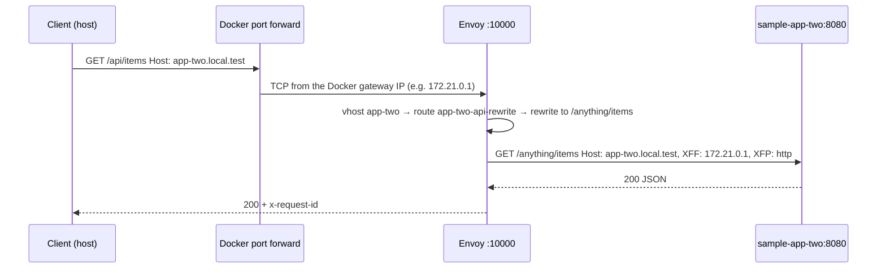

# Architecture

## Components

| Component | Image | Role | Exposure |
|---|---|---|---|
| `envoy` | built from `envoy/Dockerfile`: `envoyproxy/envoy:v1.40.2` (official, pinned) + `curl` + `entrypoint.sh` | Front proxy using native static config from `./envoy` (read-only mount) | Listener `:10000`, published as `${ENVOY_BIND_ADDRESS:-127.0.0.1}:${ENVOY_HTTP_PORT:-8080}`. Admin on a Unix socket only (no network port). |
| `sample-app-one` | built from `examples/app-one` (`python:3.13.18-alpine3.24`) | Echo backend on `:8000`; replies with JSON naming itself | `envoy-local` network only |
| `sample-app-two` | built from `examples/app-two` (`mccutchen/go-httpbin:2.25.0`) | httpbin on `:8080` (`/anything`, `/status`, `/delay`, …) | `envoy-local` network only |
| `routes-ui` | built from `routes-ui/Dockerfile`: the same pinned Envoy image + Python 3 + PyYAML | Web UI to list, add and remove routes. Runs `scripts/add-route.sh` in container mode. | `127.0.0.1:${ROUTES_UI_PORT:-8090}`. Writes `./envoy`; admin socket read-only. |

All services sit on one user-defined bridge network, `envoy-local`. Docker's embedded DNS resolves the Compose service names there, and Envoy's `STRICT_DNS` clusters use those names.



## Version selection

`v1.40.2` is the newest patch of the newest stable minor line (released 2026-10-27, the day this project was built). It is the default of the `ENVOY_VERSION` build argument in `envoy/Dockerfile` and `compose.yaml`, with an override in `.env`. Changing it requires `docker compose up -d --build`.

The configuration uses only stable v3 APIs and passes `envoy --mode validate` without deprecation warnings on this version. Envoy Gateway pins its own Envoy version per release. For closer parity, set `ENVOY_VERSION` to the version your production Envoy Gateway release uses, then run `./scripts/validate.sh`.

## Design decisions

| Decision | Why |
|---|---|
| **Envoy image built from `envoy/Dockerfile`** (as in the reference example) | Pins the official image through the `ENVOY_VERSION` build argument and adds `curl`, so the health check and admin queries need no workarounds. The config is mounted rather than copied, so edits only need `docker compose restart envoy`. |
| **`envoy/scripts/entrypoint.sh`** (as in the reference example) | Like the reference, it prints the effective settings and can dump the config (`ENVOY_DUMP_CONFIG=true`). Unlike the reference, it does **not** substitute environment variables into the YAML with `sed`. That approach is fragile, and it means the file in git isn't the file that runs. Extra arguments go to Envoy (`validate.sh` uses `--mode validate`). |
| **One static `envoy.yaml`** rather than `routes/` and `clusters/` files | Tested before deciding. Splitting works through Envoy's file-based config (`path_config_source` for RDS/CDS), but on v1.40.2: (1) `envoy --mode validate` does not read those files and reports OK even when they're broken; (2) Envoy starts even if a file is rejected, just without routes or clusters; (3) unknown fields are ignored unless `--reject-unknown-dynamic-fields` is set. A single static file fails fast at validation and startup. If the file grows too large, revisit the split and add a validation step that checks Envoy's `update_rejected` stats. |
| **Backend addresses written literally** | Same reason as the entrypoint. Configurability comes from editing a cluster's `address`/`port_value`, which validation then checks. |
| **`STRICT_DNS` clusters** | They re-resolve Docker DNS every 5s, so restarted or scaled containers are picked up. An unresolvable name doesn't block startup. |
| **Admin on a Unix socket** (`/run/envoy-admin/admin.sock` in the named volume `envoy-admin`), never on a network port | Envoy's admin API can change runtime state, so it must not be reachable over the network. It is reachable only by containers that mount the volume: Envoy (health check, `scripts/admin.sh`), `routes-ui` (to restart Envoy after a route change) and the opt-in `compose.admin.yaml` forwarder. An earlier design shared Envoy's network namespace to reach a loopback admin instead. Tested and rejected: when Envoy restarts through its restart policy (crash, `/quitquitquit`), Docker gives it a new network namespace, and the sharing container is left on the dead one. |
| **Health check with `curl` on admin `/ready`** | Uses the `curl` added in the Dockerfile, over the admin Unix socket. app-two (go-httpbin) has no health check, because its image has no shell or HTTP client. |
| **Two different sample backends** | app-one (echo) shows exactly what arrives upstream. app-two (go-httpbin, like the reference's httpbin) adds `/status/<code>` and `/delay/<n>`, which let the smoke test cover status pass-through and route timeouts. |
| **Hardened containers** | Non-root users, `cap_drop: [ALL]`, `no-new-privileges`, read-only root filesystem, read-only config mount, no Docker socket. |
| **`restart: unless-stopped`** | Restarts after crashes and Docker restarts, but respects `docker compose stop`. |
| **`extra_hosts: host.docker.internal:host-gateway`** on Envoy | Lets routes target apps running on the developer's machine, or container ports published to it, as `host.docker.internal:<port>` (`add-route.sh … host:PORT`). Tested: without it the name does not resolve on the user-defined `envoy-local` network, even on Docker Desktop. On Linux, `host-gateway` maps to the Docker bridge gateway, so host apps must listen on `0.0.0.0` (not tested here). |
| **`scripts/add-route.sh`** | One command per route for developers: hostname, target, optional `--path` prefix and `--rewrite` prefix. It writes ordinary native YAML at the marker comments (`# @add-route:…`) in `envoy.yaml`: one virtual host per hostname with **one line per route**, and one cluster per distinct target. The one-line shape lets a bash script on stock macOS (bash 3.2, BSD awk, no YAML library) re-read, re-sort (longest prefix first, `/` last) and rewrite a hostname's block reliably. If a generated block no longer has that shape (hand edits), the script refuses to change it instead of guessing. It validates, rolls back on failure and restarts Envoy. It is scaffolding, not a generator: nothing outside the hostname being changed is rewritten, and the YAML in git is what Envoy loads. `--rewrite /` uses `regex_rewrite`, because `prefix_rewrite: /` would produce `//`. Not supported: exact paths, header matches, custom timeouts (hand-written). |
| **`routes-ui` runs the same `add-route.sh`** | There's no second implementation to keep in sync. With `ADD_ROUTE_MODE=container` the script validates with the `envoy` binary in its own image (built from the same `ENVOY_VERSION`) and restarts Envoy with `POST /quitquitquit` on the admin socket. Docker's `restart: unless-stopped` starts Envoy again in about a second (tested). No Docker socket is mounted anywhere. The only extra permission is write access to `./envoy`, which is unavoidable: with static configuration, the routes *are* that file. The UI reads `envoy.yaml` with PyYAML to show all virtual hosts. Only blocks between `add-route` markers can be removed. Requests are accepted only with a `127.0.0.1`/`localhost` `Host` header, and changes only as same-origin JSON (CSRF and DNS-rebinding protection; tested). |
| **No hot reload** | Envoy loads `envoy.yaml` once. Routes loaded from watched files (`path_config_source` with `watched_directory`) were tested: on Docker Desktop the container never saw the host's file changes (atomic rename or in-place write), so changes still needed a restart. A restart takes a few seconds and `add-route.sh` does it automatically. |
| **Opt-in admin access (`compose.admin.yaml`)** | A `socat` forwarder connects to the admin socket (volume mounted read-only) and publishes it on host `127.0.0.1:${ENVOY_ADMIN_PORT:-9901}`, without changing `envoy.yaml`. It is active only when the file is passed with `-f`. It survives Envoy restarts, including `/quitquitquit` (tested). |
| **Entrypoint environment** | `ENVOY_LOG_LEVEL` and `ENVOY_DUMP_CONFIG` come from `.env` through `compose.yaml`. `ENVOY_CONFIG` (default `/etc/envoy/envoy.yaml`) is read by the entrypoint but not passed by `compose.yaml`. It exists for running the image directly (`docker run -e ENVOY_CONFIG=…`), so setting it in `.env` has no effect. |

## Integrating with an existing Docker network

Goal: let Envoy route to containers of another Compose project (for example `~/code/myapp`) without editing that project's Compose file, Dockerfile or images, and without breaking the standalone workflow.

The mechanism is [compose.integration.example.yaml](../compose.integration.example.yaml), which adds one external network to the `envoy` service. Compose merges it with `envoy-local`, so Envoy ends up on both networks. This was tested: Envoy joined a demo network, resolved a container there by name, kept serving the sample apps, and detached again without the demo container restarting.

### 1. Identify the network

```bash
docker network ls                                   # Compose names networks <project>_<network>, e.g. myapp_default
docker network inspect myapp_default \
  --format '{{range .Containers}}{{.Name}} {{.IPv4Address}}{{"\n"}}{{end}}'
```

The app must be running, or at least its network must exist. An `external: true` network is never created or removed by this project.

### 2. Connect Envoy

```bash
cp compose.integration.example.yaml compose.integration.yaml   # gitignored
echo 'APP_NETWORK=myapp_default' >> .env
docker compose -f compose.yaml -f compose.integration.yaml up -d --wait
docker inspect -f '{{range $k,$v := .NetworkSettings.Networks}}{{$k}} {{end}}' envoy-local-envoy-1
# -> envoy-local myapp_default
```

To avoid typing `-f` every time, add `COMPOSE_FILE=compose.yaml:compose.integration.yaml` to `.env`. Plain `docker compose …` commands will then include the override. If `APP_NETWORK` is missing, Compose stops with an explicit error instead of creating a wrong network.

To join several app networks, add more entries such as `app2` with their own `external: true` and `name:`.

### 3. Reference the app by DNS name and container port

On a shared network, Docker DNS resolves:

- the **Compose service name** (for example `web`),
- the **container name** (for example `myapp-web-1`),
- any **network aliases** the app defines.

Use the **container port** (the port the process listens on inside the container), not a host-published port:

```yaml
- name: myapp_web
  type: STRICT_DNS
  dns_lookup_family: V4_ONLY
  connect_timeout: 5s
  load_assignment:
    cluster_name: myapp_web
    endpoints:
      - lb_endpoints:
          - endpoint:
              address:
                socket_address: { address: myapp-web-1, port_value: 3000 }
```

Then add a virtual host (for example `myapp.local.test`) that routes to `myapp_web`, and run `./scripts/validate.sh && docker compose restart envoy`. Check DNS with `docker compose exec envoy getent hosts myapp-web-1`.

Shortcut: `./scripts/add-route.sh myapp.local.test container:myapp-web-1:3000` (add `--path /api --rewrite /` for a path-specific route) writes both blocks, validates, restarts Envoy, and warns if the name doesn't resolve. The routes UI does the same from a browser.

If the app's container already **publishes** its port to the host, joining its network isn't necessary: target it as `host:<published-port>` (Envoy reaches it through `host.docker.internal`). Joining the network is the cleaner option when the app has no published ports, or when you want to avoid publishing them.

### 4. Avoid hostname and service-name collisions

Once Envoy is on several networks, a short name like `web`, `api` or `app` may exist on more than one of them. Docker then returns whichever network answers, and the result is unpredictable.

- Prefer **container names** (`myapp-web-1`), which are unique per Docker host. Compose derives them from `<project>-<service>-<index>`.
- Or reference a **project-specific alias** the app already defines.
- The standalone samples are deliberately named `sample-app-one` and `sample-app-two`, and the network `envoy-local`, so they are unlikely to clash with real services.
- Keep cluster names (`myapp_web`) and virtual-host domains (`myapp.local.test`) unique within `envoy.yaml`. Envoy rejects duplicate cluster names, and `validate.sh` reports duplicate domains.
- If the app's Compose file pins `container_name:` values, use those.

### 5. Preserve the standalone workflow

- `compose.yaml` is never edited for integration, so `docker compose up -d` without the override always gives the standalone stack.
- Clusters for apps that aren't running don't break anything. Envoy starts, and only those hostnames return `503` (`UH`). Integration routes can therefore stay in `envoy.yaml`.
- `./scripts/smoke-test.sh` exercises only the samples, so it keeps passing whether or not integration routes exist.

### 6. Disconnect without disrupting the app

```bash
docker compose up -d --wait        # without -f compose.integration.yaml (and without COMPOSE_FILE)
```

Compose recreates the Envoy container on `envoy-local` only. Nothing in the app's project is restarted or modified. `docker compose down` here also leaves the external network alone. For a temporary detach without recreating, run `docker network disconnect myapp_default envoy-local-envoy-1`. The next `up` with the override reattaches it.

### 7. Don't publish backend ports

Once Envoy reaches the app over the Docker network, the app no longer needs `ports:` on the host for routing. Leave the application's own Compose file as is. If it already publishes ports, that's its choice. For new services, prefer `expose:` or nothing at all. A port published to `0.0.0.0` bypasses Envoy and its header policy entirely.
